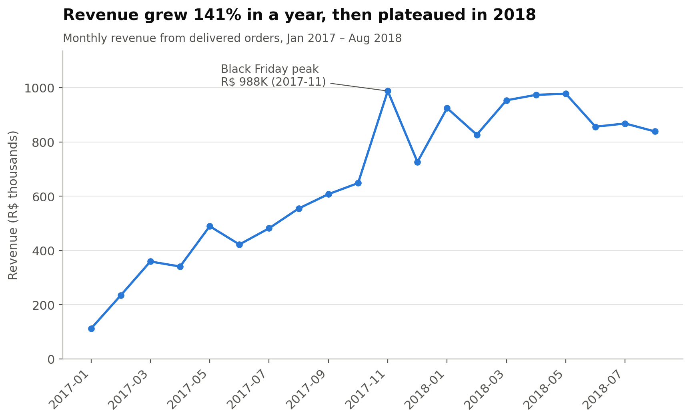
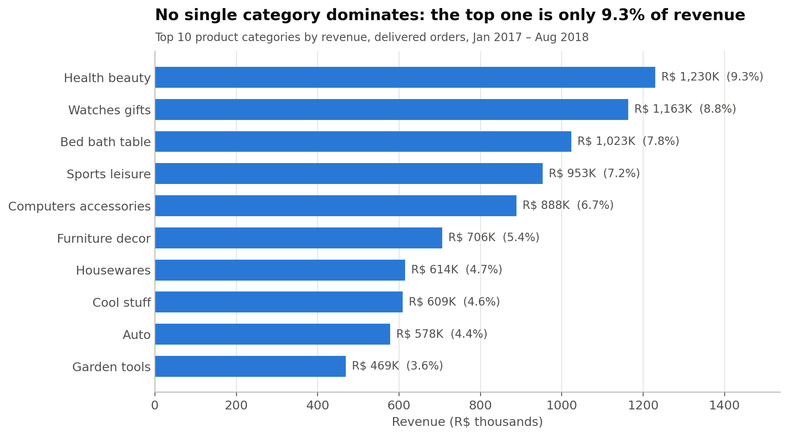
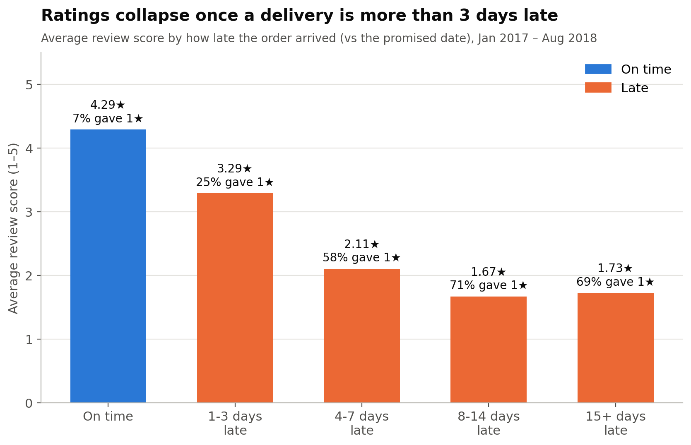
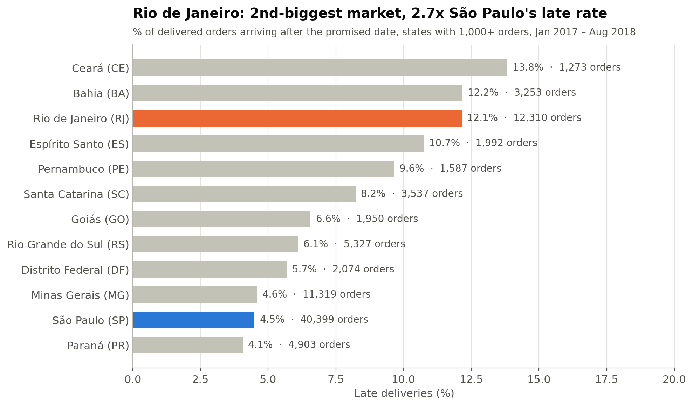
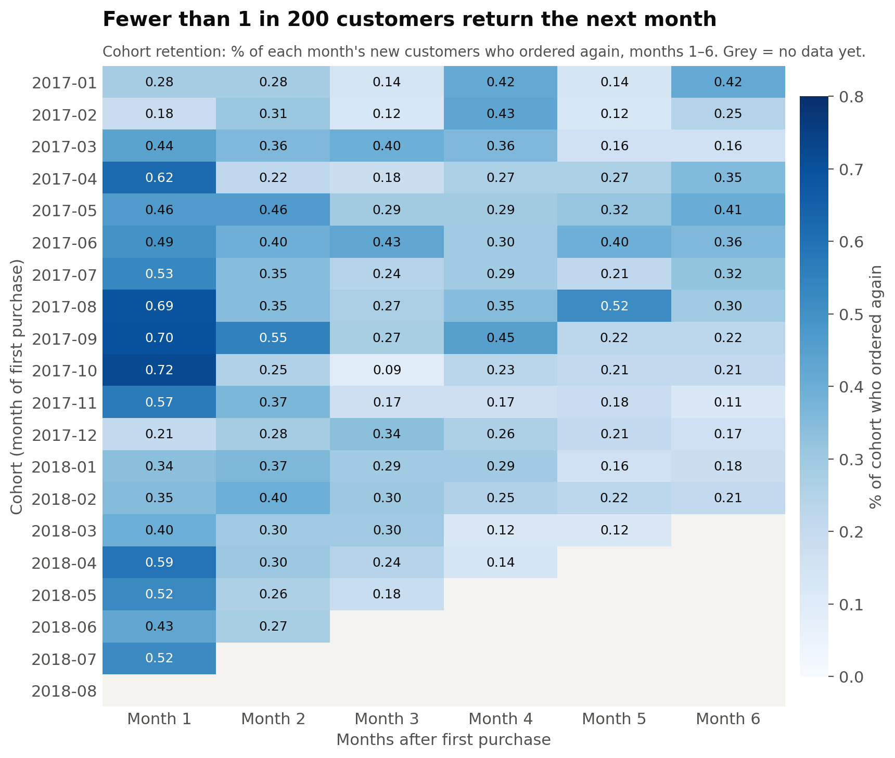

# E-Commerce Sales & Customer Analysis

An end-to-end analysis of **99K+ orders** from Olist, a Brazilian e-commerce marketplace, using **SQL** and **Python (pandas, Matplotlib)**.

The goal was to answer three business questions:
1. How is revenue growing, and where does it come from?
2. Why are some customers unhappy?
3. Do customers come back?

---

## Key Findings

### 1. Revenue grew 141%, then stalled
Revenue for Jan–Aug 2018 was **R$ 7.22M vs R$ 2.99M** in the same months of 2017 (+141%). But average month-over-month growth fell from **~23.5% in 2017 to ~2.5% in 2018**. November 2017 (Black Friday) was the peak month at **R$ 988K**, 16.6% of all 2017 revenue.



### 2. Revenue is spread across many categories
No category dominates: the largest (health & beauty) is only **9.3%** of revenue, and the top 10 together are 62.5%. Watches & gifts earns from high-value orders (avg **R$ 212**), while bed/bath/table earns from volume (most orders, avg R$ 110).



### 3. Late deliveries are the biggest driver of bad reviews
Only **6.8%** of orders arrive after the promised date, yet they account for **~37% of all 1-star reviews**. Late orders average **2.27★ vs 4.29★** for on-time orders, and ratings collapse once a delivery is **more than 3 days late** (58%+ of those orders get 1 star).



### 4. Delivery problems are concentrated in a few places
**Rio de Janeiro** is the 2nd-largest market and sits next to São Paulo, yet **12.1%** of its orders are late, **2.7x São Paulo's 4.5%**. It alone causes ~23% of all late orders. The **Northeast** region also has about twice the late rate of the South/Southeast (12.8% vs ~6%).



### 5. 97% of customers never come back
Only **3.0%** of customers placed a second order. Month-1 retention averages **0.48%** across monthly cohorts, and it is **not improving**: 2018 cohorts return less than 2017 cohorts. Growth depended entirely on new customers, which explains the 2018 plateau.



---

## Recommendations

1. **Fix delivery in Rio de Janeiro first**, then the Northeast (carrier review, regional fulfilment). Halving late orders could cut about **1,500 1-star reviews** (~16% of all 1-stars).
2. **Proactively update customers** whose orders are likely to miss the promised date, before they pass 3 days late.
3. **Run a second-purchase campaign** within 1–2 months of the first order (especially for Black Friday customers), and track month-1 retention as a KPI.
4. **Raise basket size:** 90% of orders contain a single item. Bundles and "frequently bought together" suggestions in high-volume categories could lift revenue per order.

---

## Data

- **Source:** [Brazilian E-Commerce Public Dataset by Olist](https://www.kaggle.com/datasets/olistbr/brazilian-ecommerce) (Kaggle)
- **Size:** 99,441 orders across 9 related tables (orders, order items, customers, payments, reviews, products, sellers, geolocation, category translation)
- **Period analysed:** Jan 2017 – Aug 2018 (months before and after are incomplete)

### Key definitions & data decisions
| Term | Definition |
|---|---|
| Revenue | Sum of product `price` from order items (shipping excluded), delivered orders only |
| Late | Delivered on a later **day** than the estimated delivery date shown to the customer |
| Customer | `customer_unique_id`, because `customer_id` is created fresh for every order and cannot track repeat buyers |
| Cohort | Customers grouped by the month of their first purchase |

Data quality was checked first: 8 delivered orders without a delivery date and 610 products without a category were found. Undated orders were excluded from delivery analysis; uncategorised products were kept as "unknown".

---

## Methods

- **SQL (SQLite):** joins across 5 tables, CTEs, aggregation, `CASE` binning, and window functions (`LAG` for month-over-month growth, `SUM() OVER` for running totals and revenue share, `RANK`)
- **Python (pandas):** repeat-purchase analysis and monthly cohort retention (`groupby`, `transform`, `unstack`)
- **Matplotlib:** 5 charts, each titled with its main finding

---

## Project Structure

```
ecommerce-sales-analysis/
├── load_data.py            # Loads the 9 CSVs into a SQLite database (olist.db)
├── queries/
│   ├── 01_explore.sql      # Data exploration & quality checks
│   ├── 02_revenue.sql      # Monthly revenue, MoM growth, top categories
│   └── 03_delivery.sql     # Late deliveries vs reviews, by delay and state
├── analysis.ipynb          # Customer retention, cohort analysis, charts
├── charts/                 # The 5 charts used in this README
├── notes.md                # Full step-by-step findings with all numbers
└── requirements.txt
```

---

## How to Run

1. Download the dataset from Kaggle and unzip the CSV files into a `data/` folder.
2. Install the libraries:
   ```
   pip install -r requirements.txt
   ```
3. Build the database:
   ```
   python load_data.py
   ```
4. Run the SQL files in any SQLite tool (e.g. DB Browser for SQLite) against `olist.db`.
5. Open the notebook:
   ```
   python -m notebook
   ```
   and run `analysis.ipynb` from top to bottom.

---

**Tools:** SQL (SQLite), Python, pandas, NumPy, Matplotlib, Jupyter
